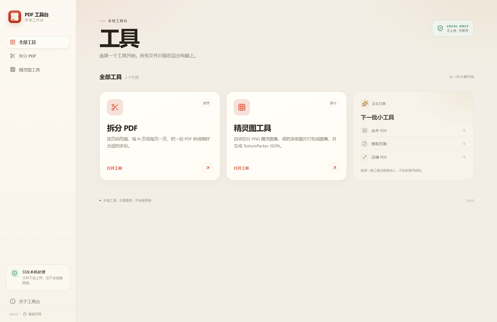
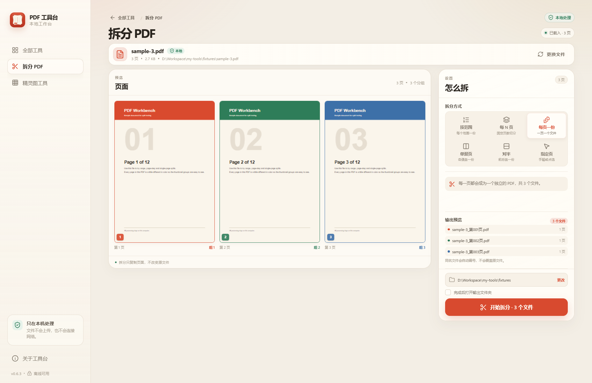
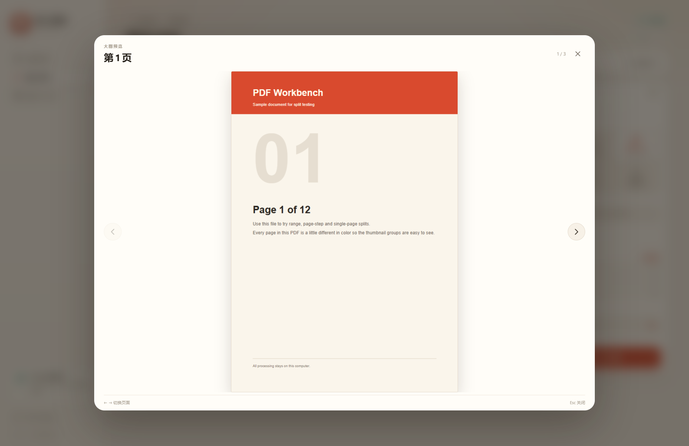
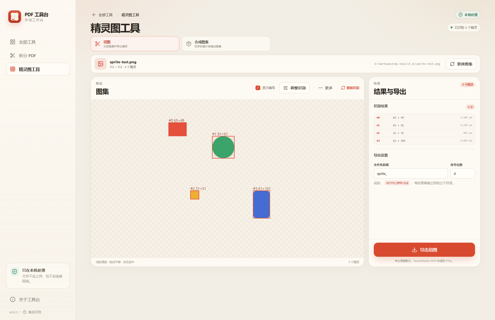
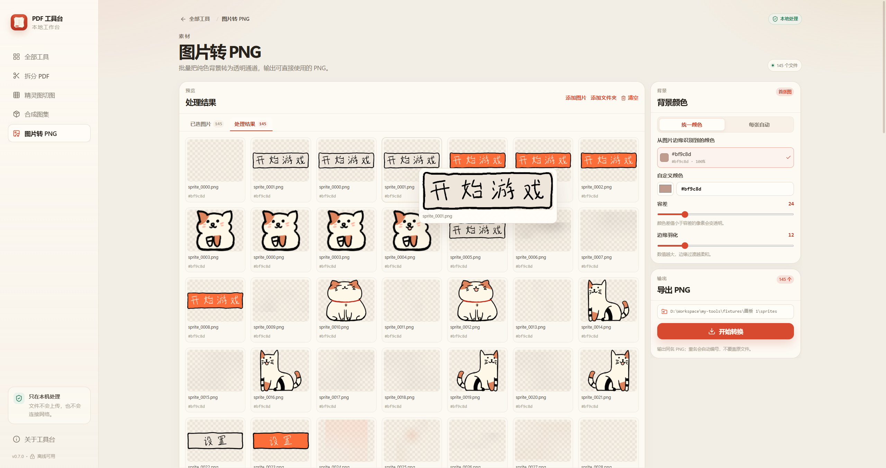

# PDF 工具台

一个轻量、纯本地的 Windows 桌面工具。当前提供 **PDF 拆分**、**精灵图切图**、**合成图集** 和 **图片转 PNG**，首页按可扩展的工具列表设计，后续可以继续加入合并、提取页面、压缩等工具。

所有文件都只在本机处理：没有账号、没有上传、不依赖远程接口。



## 直接使用

- 安装版：`release/PDF工具台_0.7.0_x64_zh-CN.msi`
- 便携版：`release/PDF工具台-0.7.0-portable.zip`，解压后双击 `PDFWorkbench.exe`
- 也可以直接运行：`release/PDFWorkbench.exe`

系统要求：Windows 10 / 11 x64、WebView2 Runtime（Windows 11 通常自带）。安装包未签名，Windows SmartScreen 可能提示未知发布者。

界面为自适应布局：默认窗口 1280×840，最小窗口 1080×640；宽屏下内容区会扩展到 1440px，页面预览使用自适应网格，面板高度随内容收缩。

## 功能

### PDF 拆分

- 按范围拆分：`1-3, 5, 8-10`，每个范围生成一份 PDF
- 按固定页数拆分：每 N 页一份，最后一份可以不足 N 页
- 每页一份
- 单双页拆分（交错拆分）：奇数页、偶数页各生成一个 PDF
- 对半拆分：从中间分成前后两份，前一半向上取整
- 指定页拆分：手输页码或在预览区点选页面，只输出选中页；也可全选、清空
- 页面缩略图支持悬停放大；非选页模式点击页面查看大图，选页模式点击页面选中、右上角按钮查看大图
- 大图查看器可翻页，支持方向键和 Esc 关闭
- 拆分前预览输出文件名、页数和保存位置
- 同名文件自动编号，不覆盖已有文件
- 临时文件 + 原子重命名，取消 / 失败时清理未完成文件





### 精灵图切图

切图和合成图集已拆分为两个独立工具，不再通过顶部模式切换。

- 3:1 布局：左侧图集预览，右侧导出卡片 + 识别参数
- 导出卡片提供文件名前缀、序号位数、预览和导出按钮
- 识别结果通过预览弹窗查看，一行五个；悬浮可看大图，点击可多选或取消，导出可只导出选中项
- 识别参数去掉 Alpha 阈值和腐蚀次数，支持保存自定义参数预设
- 一次处理一张图集；已移除批量切图和文件夹切图

- **切图**：打开带透明通道的 PNG 图集，自动检测每个精灵的矩形包围盒
- 支持最小像素数、最小边长、合并间隔、4/8 邻域连通性和导出外扩
- Konva 画布预览：滚轮缩放、拖动平移、点击选中或取消；改参数后自动重新检测
- 导出原图副本、TexturePacker JSON 和 `sprites/` 下的逐张 PNG
- 可自定义切图前缀和序号位数
- **重排**：把当前检测结果直接重新装箱成更紧凑的图集，不重新检测



### 合成图集

- 独立入口，左侧输入缩略图预览，右侧合成卡片 + 装箱参数
- 支持添加图片；添加文件夹时递归展开为图片，不再添加文件夹本身
- 合成卡片可先预览最终图集，再导出 PNG + JSON
- 支持 trim、边缘外扩、间距、单页上限、自动分页和装箱排序
- 输出按图集/图集名独占子目录，避免互相覆盖；写入前检查是否混入非本工具文件

### 图片转 PNG

- 批量选择图片，或选择文件夹递归收集图片
- 支持 PNG / JPG / JPEG / WebP / BMP / GIF 输入
- 左侧“已选图片 / 处理结果”列表切换，右侧设置 sticky
- 处理结果按当前参数生成透明 PNG 缩略图列表
- 已选图片和处理结果都支持悬浮查看大图
- 自动从首张图片边缘提取候选背景色，显示色块、十六进制值和占比
- 支持选择候选色、自定义颜色，以及“每张自动识别”
- 容差和边缘羽化可调，输出带 Alpha 的 PNG
- 左侧列表不内部滚动，页面整体滚动
- 批量进度和成功 / 失败报告，同名输出自动编号



## 技术栈

- **桌面壳**：Tauri 2（Rust + 系统 WebView2）
- **前端**：React 19 + TypeScript + Vite
- **PDF 预览 / 解析**：PDF.js
- **PDF 拆分**：pdf-lib，运行在独立 Web Worker
- **精灵图切图 / 打包**：Rust `image` 解码 + 零依赖连通域检测 / Skyline 装箱，前端 Konva 画布
- **图片转 PNG**：Rust `image` 解码 + 边缘候选色分析 + 容差 / 羽化透明通道处理
- **样式**：纯 CSS 设计系统，无 UI 组件运行时依赖
- **测试**：Vitest + Rust 单元测试

Tauri 让安装包和内存占用保持轻量；PDF.js 负责解析和渲染，pdf-lib 在 Worker 中生成拆分文件，精灵图算法在 Rust 后端执行，不阻塞界面。

## 环境要求

- Windows 10 / 11 x64
- Node.js 22+
- pnpm
- Rust stable
- Visual Studio Build Tools（C++ 桌面开发）
- WebView2 Runtime（Windows 11 通常自带）

## 开发

```bash
pnpm install
pnpm tauri dev
```

只启动前端预览（浏览器中不会写入本地文件夹，拆分结果会作为文件下载）：

```bash
pnpm dev
```

## 测试与构建

```bash
pnpm test
pnpm build
pnpm build:installer
```

Windows 安装包输出在：

```text
src-tauri/target/release/bundle/msi/
```

`build:installer` 使用 MSI + 已缓存的 WiX 工具构建，并跳过二进制补丁步骤；本地安装和运行不依赖该补丁。

## 项目结构

```text
src/
  app/                       应用壳、侧栏、关于弹窗、启动上下文
  components/
    pdf/                     共享 PDF 文件栏、页面预览、渲染队列
  lib/                       路由、格式化、文件命名、PDF.js 加载器
  pages/                     首页
  tools/
    registry.tsx             工具注册表、拖放工具选择
    types.ts                 工具清单类型
    split-pdf/
      manifest.ts            工具元信息
      SplitPdfPage.tsx       拆分页
      components/            拆分设置、结果页
      model.ts               范围解析、拆分计划、命名规则
      split.worker.ts        pdf-lib 拆分 Worker
      splitClient.ts         Worker 驱动与进度控制
    sprite-slicer/
      manifest.ts            两个工具的元信息
      SpritePage.tsx         共用的精灵图页面逻辑
      SpriteSlicePage.tsx    精灵图切图入口
      SpritePackPage.tsx     合成图集入口
      components/            Konva 画布、任务面板
      api.ts                 Tauri 命令封装
      types.ts               精灵图数据类型
    image-to-png/
      manifest.ts            工具元信息
      ImageToPngPage.tsx     图片转 PNG 页面
      api.ts                 Tauri 命令封装
      types.ts               背景色、转换报告类型
  styles/                    设计令牌、页面样式
src-tauri/
  src/lib.rs                 文件权限扩展、打开输出文件夹命令
  src/sprite/                精灵图命令、导出和后台任务
  src/image_png.rs           图片解码、边缘候选色、透明通道转换
  crates/slicer-core/        零依赖精灵图检测算法
  crates/slicer-io/          PNG 解码、切图导出、Skyline 装箱
  capabilities/              Tauri 权限白名单
  tauri.conf.json            窗口、CSP、素材协议、打包配置
```

## 扩展一个新工具

工具列表由注册表驱动。新增一个工具：

1. 在 `src/tools/` 下创建工具目录和 `manifest.ts`
2. 在 `src/tools/registry.tsx` 加入 manifest
3. 在 `toolPages` 路由表中加入懒加载页面
4. 如需要主进程能力，在 `src-tauri` 中增加受控命令
5. 添加对应测试

示例 manifest：

```ts
export const mergePdfTool: ToolManifest = {
  id: "merge-pdf",
  title: "合并 PDF",
  description: "把多个 PDF 按顺序合成一份。",
  category: "organize",
  icon: Layers3,
  route: "/tools/merge-pdf",
  keywords: ["pdf", "合并", "merge"],
  status: "available",
  order: 30,
  acceptsPdf: true,
};
```

首页不写死具体工具。工具数量达到 6 个后会自动出现搜索框；拖入 PDF 时，如果当前不在接收 PDF 的工具页，会弹出工具选择器。

首版没有引入运行时插件系统。工具在构建时注册，权限和 IPC 面更可控。

## 本地文件权限

渲染层不能任意访问文件系统。Tauri 只启用读写文件的命令权限，具体路径在用户选择或拖入文件后按需加入运行时 scope：

- 用户通过原生对话框选择 PDF / 输出目录时，Tauri dialog 会自动扩展文件 scope
- 拖放文件通过 `prepare_import` 命令扩展源文件及源目录 scope
- 输出先写入同目录临时文件，全部成功后再重命名
- 渲染层只能通过白名单 API 读写这些已授权的路径

## 已知限制

- 加密 PDF 暂不支持，会给出明确提示
- 一次只处理一个 PDF
- 精灵图工具主要支持带透明通道的 PNG，JPEG/WebP 和无 alpha 图集暂不支持
- 安装包未做代码签名，Windows SmartScreen 可能提示未知发布者
- 大文件预览会经过缩略图懒加载和并发限制，首次滚动仍可能有短暂等待

## 隐私

PDF 工具台不收集文件内容，不上传文件，也不依赖远程接口。PDF.js 的 CMap、字体和 WASM 资源在构建时打包到本地。

## License

个人工具项目模板。第三方依赖遵循各自许可证：Tauri（MIT/Apache-2.0）、React（MIT）、PDF.js（Apache-2.0）、pdf-lib（MIT）。
